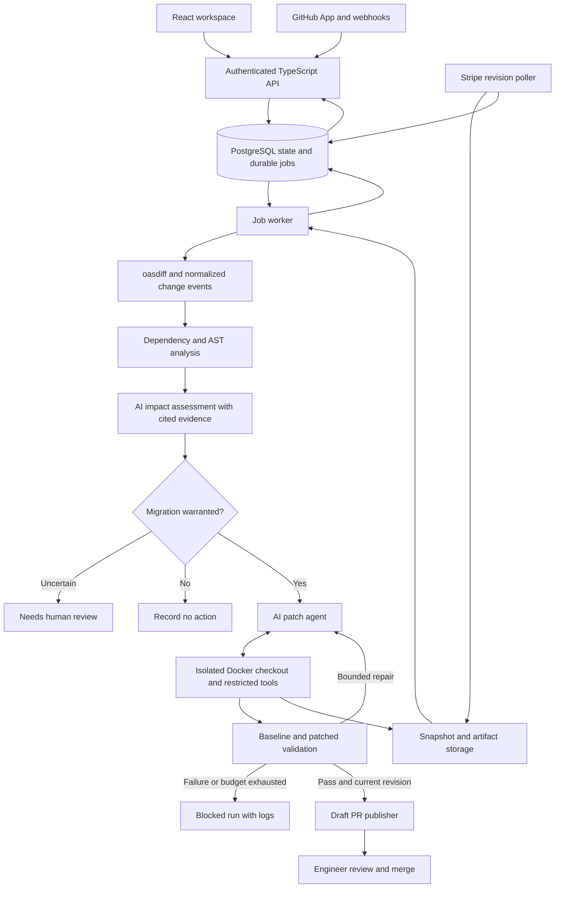

# Refit: current implementation and architecture goal

## Goal

Connect a GitHub repository once. Refit watches Stripe's API specification, identifies changes relevant to that repository, generates a focused migration in an isolated checkout, runs the project's checks, and opens a draft PR with evidence. An engineer reviews and merges.

AI helps interpret application intent and edit code. Source diffs, job state, validation outcomes, and publishing permissions remain deterministic.

## What exists now

| Capability | Implemented state |
| --- | --- |
| Website and workspace | React/Vite frontend, interactive demo, docs, sample repositories/runs and configuration export. Workspace data remains illustrative. |
| Local pipeline | Runnable TypeScript CLI in `pipeline/`; accepts a real local repository and two supplied OpenAPI JSON files. No credentials or network needed. |
| Dependency detection | Reads Stripe declarations from package manifests, including nested workspaces. Reports declared ranges, not resolved lockfile versions. |
| Specification comparison | Detects direct property removals in existing non-composed OpenAPI 3 component schemas. This limited detector is **not oasdiff** and does not implement the full PRD diff engine. |
| Code analysis | TypeScript AST and lexical symbols trace local ESM Stripe clients, awaited PaymentIntent calls, immutable aliases, direct/string-indexed reads and destructuring. |
| Evidence | JSON report with schema pointers, file/line/column, confirmed local matches versus review candidates, source hashes and repeatable run ID. |
| Replay | Hand-authored minimal fixtures reproduce Stripe's documented 2022-11-15 `charges` removal. These are not archived upstream snapshots. |
| Verification | 15 pipeline tests plus the existing 16 frontend tests. CLI integration tests include report writing and overwrite refusal. |
| Service integration | No HTTP API, database, queue, GitHub App, scheduled monitoring, model calls, sandbox, patches or PR publication. The CLI is not connected to the frontend. |

The analyzer is conservative: `affected` means a removed property has a locally traced PaymentIntent receiver. It does not prove that the repository is upgrading to the relevant API version. `needs-review` means Stripe is present but no such direct match is confirmed. `no-stripe-signal` means the supported scan found no Stripe import/dependency signal; it does not prove the absence of REST calls or dynamic integrations.

Cross-file wrappers, CommonJS client resolution, webhooks, mutation, list responses and dynamic flows need additional analysis. A same-named property on an unproven receiver is a review candidate, not confirmed evidence. No-match results never become an automatic “safe” decision.

## Run it

```sh
npm ci
npm run stripe:replay

npm run stripe:scan -- \
  --repository /absolute/path/to/repository \
  --before /absolute/path/to/previous-openapi.json \
  --after /absolute/path/to/current-openapi.json \
  --output /absolute/path/to/new-report.json
```

Omit `--output` to print JSON. An existing output file is never overwritten. Exit code 0 means the scan completed, including when it found affected code; exit code 1 means invalid arguments or a scan/output error. The report has no timestamps, so the same supported inputs produce the same run ID. Reports do not include full source snippets or constructor arguments.

The scanner reads source files without importing them, installing dependencies or executing scripts. It skips dependency/build directories and symlinks, reports skipped symlinks, and rejects repositories over 10,000 relevant files, 2 MiB per file or 50 MiB total. Malformed source and JSON fail explicitly.

The frontend's TypeScript 7 package does not expose the legacy compiler API used by this analyzer. `typescript-compiler` is an npm alias for TypeScript 5.9.3, used only by the local pipeline. Syntax newer than that parser supports fails explicitly. `tsx` runs the CLI; neither is bundled into the browser.

## Target architecture — planned



### 1. Control plane

The existing React app calls a TypeScript API for installations, repositories, changes, runs and artifacts. Authentication and installation ownership checks apply to every resource. GitHub webhooks are signature-verified and deduplicated. HTTP handlers validate requests and enqueue work; long jobs run separately.

### 2. Persistence and orchestration

PostgreSQL holds tenants, installations, repositories, provider revisions, normalized changes, impact decisions, runs and durable jobs. Jobs have idempotency keys, leases, bounded attempts, retry scheduling and explicit failure states. The planned uniqueness boundary for a migration is repository + base revision + change identity; a repeated delivery must not publish another PR.

Local artifact storage supports development; an S3-compatible store holds deployment snapshots, patches and logs. Keep large files out of ordinary database rows. Polling and workers must recover after restart. No Redis or separate workflow platform is needed for the initial design.

### 3. Provider ingestion and deterministic analysis

A Stripe adapter resolves and fetches pinned upstream OpenAPI revisions, stores their SHA, content hash and provenance, and calls **oasdiff** for a complete machine-readable comparison. Normalize supported events into provider-independent records. Replace the current narrow property detector at this boundary; do not expand it into a homegrown full OpenAPI differ.

The scanner then checks manifests and lockfiles, API-version configuration, imports, usages and references. Extend the current analyzer with cross-file symbol flow, typed SDK responses, wrappers and webhook payloads. Preserve uncertainty rather than filtering ambiguous repositories out. The generic worker consumes adapter results so another API provider can be added without rewriting orchestration.

### 4. AI responsibilities

Use OpenAI's Responses API behind a single server-side integration with a configurable `OPENAI_MODEL`. Select the deployed model using migration evaluations and measured cost; do not couple business logic to a model name.

Two steps share the same evidence bundle:

1. **Impact assessment:** return a schema-validated decision, affected usage IDs, source references, uncertainty and a proposed migration approach. Reject references not present in the evidence bundle. Schema validity alone does not prove correctness.
2. **Patch generation:** work in an isolated checkout using narrow tools for reading/searching files, applying patches and invoking predefined validation commands. The worker executes tool calls and enforces path, attempt, time and cost limits.

The model receives the provider change, relevant source context, repository configuration and actual tool results. Repository text is untrusted input, not authorization. The model cannot invent a passing check, choose its own publishing permissions, access installation credentials or merge a PR. A refusal, timeout, malformed result or unresolved impact becomes a visible run state.

This design uses [function calling](https://developers.openai.com/api/docs/guides/function-calling) for controlled tools and [structured outputs](https://developers.openai.com/api/docs/guides/structured-outputs) for validated decisions. No AI is needed to execute the current replay.

### 5. Execution and validation

Run baseline checks on the pinned base revision first, then generate a patch and run the configured typecheck/lint/tests. Store exit codes, logs, revision and artifact hashes for both runs. Baseline failures must be distinguishable from migration regressions.

Sandbox workers use disposable non-root containers with resource/time limits, a restricted filesystem and controlled network access. Installation and application credentials stay outside the container. Dependency installation is an explicit sandbox stage. Cleanup runs on success, failure and cancellation. A Docker container alone is not a complete boundary for arbitrary hostile repositories; assess stronger isolation before opening the service broadly.

For the historical example, `charges` is a collection while `latest_charge` identifies the most recent charge. A list-to-single-value replacement may silently change business behavior. The migration must preserve the caller's intent and validate expansion/null handling. This is why today's pipeline reports evidence rather than applying a blind rename. See [Stripe's change documentation](https://docs.stripe.com/changelog/2022-11-15/removes-charges-attribute-paymentintent).

### 6. Publication and product integration

Only the publisher owns the short-lived GitHub installation token. It checks installation access, current base revision, passing recorded validation, allowed patch paths and idempotency before pushing a branch and opening a draft PR. A base revision change invalidates earlier validation and requires rerunning. The PR contains the provider source, exact usages, diff explanation and real check results. Refit never auto-merges.

The frontend then renders API-backed runs with loading, empty, failure and cancellation states. Existing illustrative records remain clearly separated from connected repositories.

## Delivery order

1. **Completed:** offline Stripe evidence scan, deterministic replay, tests and run instructions.
2. **Provider ingestion:** pinned real snapshots, provenance, oasdiff, historical corpus and API-version applicability.
3. **Service:** authenticated API, PostgreSQL state/queue, GitHub installation and read-only checkout ingestion; connect actual reports to the workspace.
4. **Execution:** disposable sandbox, baseline validation and reproducible check artifacts.
5. **AI:** schema-validated impact assessment, restricted patch tools, bounded repair and fixture-based evaluations.
6. **Publication:** idempotent draft PRs, stale-revision checks, audit trail and operational limits.

The existing CLI functions can be called from a worker, but none of the planned services are implied to exist yet. Keep the current npm layout until multiple deployable packages justify the PRD's proposed workspace migration.
