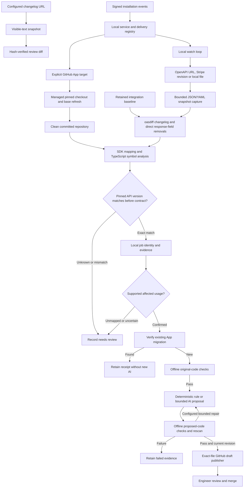
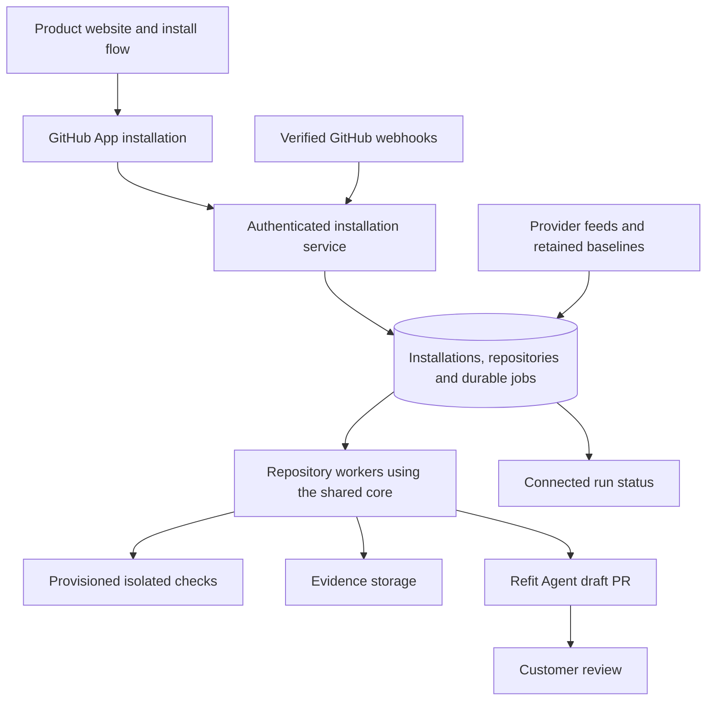

# Refit architecture

Configured `requestPropertyRenames` cover top-level JSON body fields on mapped SDK calls after checking that the recorded operation changes only by those names. Direct, quoted and shorthand properties retain their values and other arguments; uncertain requests stop for review, and these explicit rules use no AI generation or repair. See [request migrations](REQUEST-MIGRATIONS.md).

Refit implements an installation-aware local service, approved repository workflows, API migration workers and explicit GitHub App publication. The website explains the product and shows illustrative runs; it does not control the service. The pipeline has been exercised on the independent Stripe billing application and with the actual OpenAI SDK against simulated HTTP contracts. Supported [class-held](CLASS-CLIENTS.md) and [helper-parameter](HELPER-CLIENTS.md) clients reuse provenance, API-version and migration gates; uncertain origins stop automation.

A checked-in configuration can group up to eight named integrations under one operator approval. The service expands that group into independent workers and draft PRs, retains scoped inputs and job evidence, and supports individual retries. Contract-source and version failures are evaluated per integration; changed approved inputs require group reapproval. The shared repository remains the scan boundary. See [multi-integration architecture and usage](MULTIPLE-INTEGRATIONS.md).

## Implemented pipeline

| Component               | Current behavior                                                                                                                                                                                                                                      | Boundary                                                                                                                                                                                                     |
| ----------------------- | ----------------------------------------------------------------------------------------------------------------------------------------------------------------------------------------------------------------------------------------------------- | ------------------------------------------------------------------------------------------------------------------------------------------------------------------------------------------------------------ |
| Sources                 | Stripe commit discovery, pinned OpenAPI downloads, public HTTPS documents with ETags, local JSON/YAML files, and up to eight configured changelog pages or RSS 2.0/Atom feeds per target; hashes and provenance retained | No automatic source discovery, authenticated provider feeds or arbitrary crawler; external OpenAPI refs disabled; documentation diffs are review-only                                                                       |
| Contract comparison     | Shared `oasdiff` changelog for breaking and non-breaking changes; direct component-property detector supplies code evidence                                                                                                                           | General contract detection is broader than automatic code mapping                                                                                                                                            |
| Provider configuration  | SDK package/import constructors and resource-method response schema mappings; optional OpenAPI `operationId` links mapped SDK calls to a unique baseline path and method; preflight resolves local `$ref` aliases and rejects missing or unsupported mappings; built-in Stripe and real OpenAI SDK conformance fixture; optional AI adapter suggestions are validated against observed calls and contract schemas | Mappings require verification; adapter suggestions are advisory; arbitrary SDKs and languages are not inferred automatically; unconfigured breaking changes mapped to calls remain review-only                                                                 |
| Analyzer                | TypeScript AST/symbols trace immutable ESM/CommonJS clients, direct relative named/default imports and static requires, calls affected by mapped breaking contract changes, awaited SDK calls through named nested resource paths, nested component-schema `$ref`s, literal indexes, const `for...of`, inline array callbacks, immutable aliases, and transparent wrappers | Mutations/escapes downgrade findings; dynamic indexes, named/multi-parameter callbacks, transformed array chains, inline/composed/external schemas, dynamic exports, mixed module interop, dynamic flows and webhooks remain review cases |
| Patch generation        | Narrow deterministic Stripe history migration, configured scalar-property renames and contract-checked nested moves, configured endpoint replacements after recorded-contract comparison, or exact AI replacements restricted to confirmed files; imported context is read-only                                                                              | Configured mappings are operator-authored assumptions; no model tools or unrestricted edits, and checks do not establish all semantics                                                                        |
| Validation              | Clean HEAD archive; baseline before generation; optional cached, lockfile-pinned npm preparation; separate offline containers; scoped edits, rescan, stale-revision gates and up to two repairs                                                       | Bounded npm/pnpm roots and workspaces; workspace bins, private registries and lifecycle-dependent packages need a custom image; local Docker is not hosted tenant isolation                                       |
| AI spending             | Token counting, durable maximum-cost reservations, actual usage accounting and a shared allowance                                                                                                                                                     | Covers this CLI's ledger, not unrelated account spending; unaccounted requests retain reservations                                                                                                           |
| Monitoring              | `watch` polls one target; `serve` schedules up to 32 configured targets; receipts survive restarts, source retries are bounded and failed migrations require explicit retry                                                                           | No hosted scheduler or customer installation enrollment                                                                                                                                                      |
| Installation service    | Loopback HTTP receiver verifies raw-byte HMAC, persists deduplicated delivery receipts and installation inventory, confirms API access, wakes approved profiles and cancels removed access                                                            | Single operator, sequential profiles, explicit checks; public HTTPS delivery requires a tunnel or host                                                                                                       |
| Repository provisioning | Explicit App target fetches a pinned managed checkout; every poll refreshes the base; approved root profiles are verified against retained input fingerprints; ownership and clean-state checks prevent overwrites                                                                                               | Repositories still need approved profiles and checks; unsupported dependency layouts need a custom image                                                                                                     |
| Publication             | App installation token or personal token; verified base/tree/parent; exact tested files; bot identity checks, collision refusal and reconciliation                                                                                                    | No auto-merge or force-push; reused App PRs are explicitly not revalidated                                                                                                                                   |
| Presentation            | Readable terminals and PR prose; technical JSON retained in evidence and collapsed PR details                                                                                                                                                         | Frontend data remains illustrative                                                                                                                                                                           |

API-version applicability is an explicit gate between scanning and paid or executable work. The pin is operator-supplied and compared with OpenAPI `info.version`. Adapter-declared constructor options and request overrides are resolved through the existing AST symbols; known conflicts block automation, and `source-verified` policy requires matching supported declarations. Dynamic sources stay unverified under the compatibility `operator-pin` policy. SDK lockfiles and provider account settings are not treated as active-version proof. See [source verification limits](API-VERSIONS.md). See [CLI version settings](CLI.md#refit-local-agent).

## Provider-independent core

`refit doctor` reuses the scanner and committed npm input checks to inspect a root `.refit.json` or an operator workflow before activation. It reports mapped and unmapped SDK methods, setup failures and the existing Docker image without executing application checks, installs or paid work. The scanner and optional adapter suggestions share the same bounded SDK call inventory. `refit enroll` separately reviews the committed workflow, baseline and adapter and can retain an exact-fingerprint approval receipt outside Git. Service targets selecting that receipt verify the fetched configuration before every poll; changed approved inputs stop for review before source capture, AI or checks. Code and current-source changes reuse approval, while normal validation and job deduplication still apply. See [repository setup](REPOSITORY-SETUP.md) and [App onboarding](APP-ONBOARDING.md).

Ingestion, OpenAPI comparison, evidence, job deduplication, AI accounting, Docker validation, and publication share one implementation. Another provider supplies an adapter and checks rather than a new orchestration pipeline. SDK resources can be dot-separated identifier paths up to 256 characters. One resolver serves mapped response tracing, observed SDK inventory and configured endpoint edits. Unawaited SDK calls are not response evidence, optional invocations are downgraded through aliases, and mutation or exposure at any resource level invalidates the affected client flows. Adapters may include explicit scalar-property rename mappings, but those mappings still need verified SDK behavior, semantic review and application checks. The OpenAI fixture exercises the shared mapping with a real SDK against an offline simulator; its replacement field is synthetic and makes no claim about OpenAI's live contract.

`oasdiff` detects changes such as removed endpoints, response types, and request requirements. Optional adapter `operationId` mappings resolve to a baseline path and HTTP method; unresolved breaking changes for that operation are joined to statically traced SDK call sites. Changes to an operation's request, response, or existence appear in evidence with their change IDs and descriptions. Unconfigured impacts remain review-only and stop automated generation/publication. Explicit `operationReplacements` can cover removed endpoints when the replacement is newly introduced with matching supported request/response, parameter, server and security contracts; direct eligible SDK calls are changed deterministically while preserving arguments. All tracked calls must be eligible and unrelated breaking changes retain their gates. These mappings remain operator-authored assumptions, and SDK/API-version rollout needs review. See [endpoint migrations](ENDPOINT-MIGRATIONS.md). The code mapper confirms removed fields in existing non-composed component schemas, following direct local `$ref` links through nested response objects and array items, including literal numeric indexes, `const` `for...of` bindings, and inline callbacks to supported array iteration methods with one identifier parameter. Breaking changes outside supported migrations stop automatic generation/publication. Property correlation uses the old operation, response status and direct schema reference; identical field names on unrelated responses do not authorize publication. Dynamic indexes, named or multi-parameter callbacks, transformed array chains, inline/composed/external item schemas and dynamic access require review.

The SDK adapter and npm lockfile do not prove which API version the application uses. Automated workflows now require an explicit operator pin and an exact match to the before contract's OpenAPI `info.version`; missing, after-version or unrelated pins stop before AI, checks and publication. This is conservative where a specification uses `info.version` for another purpose. No finding is not a safe result. Automatic adoption of new API features is outside the current scope; non-breaking changes stay in the recorded changelog.

## AI and validation

The model receives relevant changes, confirmed findings, affected source files, and at most 12 resolved import modules as read-only context. AI watch migrations can also attach saved HTML, Markdown or plain-text vendor notes within the same 64 KiB evidence limit; truncation and omitted feeds are recorded. These notes are untrusted context, not approval or proof of a breaking change. See [vendor notes](VENDOR_NOTES.md). It returns schema-validated exact replacements. Local checks reject edits outside scope, missing or ambiguous matches, overlaps and unparseable code. Refit rescans the candidate and runs the configured application checks. Repository text is untrusted evidence; it cannot choose credentials, permissions or validation commands.

A baseline failure stops before model generation. Generation uses the OpenAI Responses API with strict output, fixed maximum output, default service tier and no automatic request retries. The input-token count precedes a locked ledger reservation. Actual usage settles it, including cached input and reasoning accounting. Unknown spending remains reserved rather than assumed free. Unknown model IDs require explicit prices. Assessment is optional and advisory; it is not necessary for the patch workflow.

Validation archives committed HEAD and checks separate baseline/patched copies in disposable non-root containers. Optional npm preparation installs matching root manifest/lockfile inputs in a distinct restricted container with registry network access and lifecycle scripts disabled; validation receives only the verified dependency snapshot and stays offline. Cache identity binds committed inputs, immutable image ID and preparation recipe. Checks limit execution to 120 seconds, 1 MiB per output stream, 1 CPU, 1 GiB memory and 128 processes. Validation containers have no network, host environment, Git metadata or Docker socket. Commands may differ between old/new test contracts; both are recorded, and reviewers must assess equivalent coverage. Original repository files are not modified. See [dependency preparation](DEPENDENCIES.md) for supported lockfile shapes and boundaries.

The historical Stripe migration preserves retrieval and charge history using paginated `stripe.charges.list({ payment_intent })`, rather than substituting a single `latest_charge`. The independent billing evaluation covers successful/failed payments, refunds, history, 103 attempts and empty history under two simulated contracts. This proves those checked behaviors, not live Stripe or universal correctness.

## Local state and publication

Worker state is private and outside the scanned repository. Configuration identity includes baseline, source, repository, adapter, API-version pin, commands/image, comparison mode and publication target. Migration job identity includes committed revision, scanned content, the configured application version and breaking changes; changes to OpenAPI title or descriptive metadata do not create duplicate jobs. Changing a configuration requires fresh state; baseline advancement is explicit.

State writes use temporary files, synchronization and rename. Process locks protect budgets and jobs; verified dead local owners can be recovered. Interrupted runs reconcile a valid final manifest or require explicit retry. There is no automatic paid regeneration of an uncertain job. Details and reproducible commands are in [local automation](AUTOMATION.md).

The local service acknowledges installation deliveries after their receipt and access change are persisted, then wakes workers outside the HTTP handler. Signatures are checked against exact request bytes, delivery GUID conflicts fail closed, and unknown installed repositories do not become executable jobs. Access removal aborts the affected worker; the GitHub API confirms grants before checkout. Status requires a separate bearer token. Handler shutdown completes before releasing the service lock. Registry and per-target worker state persist outside working copies; configuration changes require fresh state. See [local service setup](LOCAL-SERVICE.md) for limits and public webhook steps.

Checkout provisioning and publication use separate repository-scoped App tokens. The checkout token has Contents read access and is supplied only through a restricted Git child-process environment. It is never persisted in remote URLs or configuration. Managed ownership, configuration hashes, clean files and expected HEAD are checked before refreshing. Global/system Git configuration, credential helpers, hooks and submodule recursion are disabled; application code is not executed while fetching. A lock protects the checkout through validation.

The publisher uses write credentials. App mode signs a short-lived JWT, discovers the authorized installation and requests a repository-scoped installation token. It verifies current base revision and the exact tested file/tree contents before publishing. Existing matching branches/PRs are reconciled; conflicting contents stop publication. A read-only preflight can reuse a verified App-authored draft for the same base and changes before generation. That result records that checks were not rerun. Human review and merge remain separate.

## Hosted product target

The local service implements verified webhook delivery, installation inventory and configured checkout scheduling. Hosting this for customers still needs authenticated installation ownership, hosted approval records and enrollment, durable hosted leases/retries, tenant-level budgets, audit records and stronger isolation. Dependency preparation covers bounded npm/pnpm roots and workspaces; unsupported settings, source-dependent bins, hosted builds and other package ecosystems need separate work. PostgreSQL can hold installations, revisions and job state; blob storage can hold larger snapshots/logs. The current HTTP handler persists and signals work rather than executing migrations in the request. Every repository must be evaluated for supported integrations and meaningful checks before execution.

API-version applicability now combines the operator pin with adapter-declared source evidence and an optional strict gate. Next reliability work should expand runtime version evidence and migration evaluations, then broaden code flows and migration categories. OpenAPI captures structural contracts; semantic changes in documentation, SDK behavior or business meaning require additional evidence. Hosted onboarding should use the existing core while preserving these limits.

See [readiness](READINESS.md), [CLI usage](CLI.md), [App setup](GITHUB-APP.md), [local service](LOCAL-SERVICE.md) and [local automation](AUTOMATION.md) for evidence and setup.
