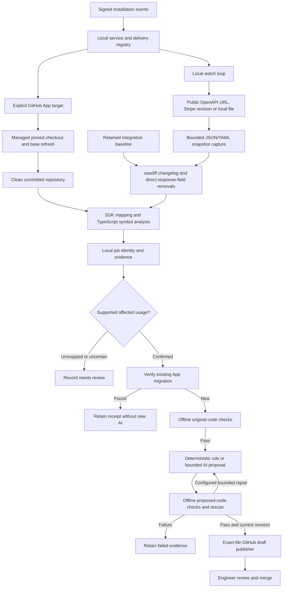
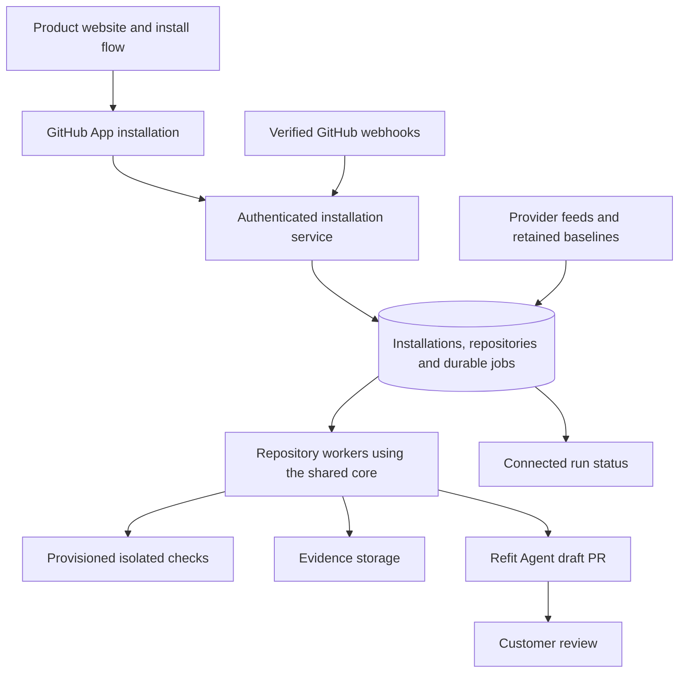

# Refit architecture

Refit 0.4 implements an installation-aware local service, API migration workers and explicit GitHub App publication. The website explains the product and shows illustrative runs; it does not control the service. The pipeline has been exercised on the independent Stripe billing application and with the actual OpenAI SDK against simulated HTTP contracts.

## Implemented pipeline

| Component | Current behavior | Boundary |
| --- | --- | --- |
| Sources | Stripe commit discovery, pinned downloads, public HTTPS documents with ETags, local JSON/YAML files; hashes and provenance retained | No arbitrary documentation crawler or authenticated provider feed; external refs disabled |
| Contract comparison | Shared `oasdiff` changelog for breaking and non-breaking changes; direct component-property detector supplies code evidence | General contract detection is broader than automatic code mapping |
| Provider configuration | SDK package/import constructors and resource-method response schema mappings; built-in Stripe, real OpenAI SDK conformance fixture | Mappings require verification; arbitrary SDKs and languages are not inferred automatically |
| Analyzer | TypeScript AST/symbols trace immutable ESM clients, direct relative named imports, shallow awaited SDK calls, aliases, direct reads, destructuring, and transparent wrappers | Mutations/escapes downgrade findings; CommonJS, transformed wrappers, dynamic flows and webhooks remain review cases |
| Patch generation | Narrow deterministic Stripe history migration or exact AI replacements restricted to confirmed files; imported context is read-only | No model tools or unrestricted edits; checks do not establish all semantics |
| Validation | Clean HEAD archive; baseline before generation; separate offline containers; scoped edits, rescan, stale-revision gates and up to two repairs | Operator supplies meaningful commands and preinstalled dependencies; local Docker is not hosted tenant isolation |
| AI spending | Token counting, durable maximum-cost reservations, actual usage accounting and a shared allowance | Covers this CLI's ledger, not unrelated account spending; unaccounted requests retain reservations |
| Monitoring | Local worker polls one configured source/repository; job receipts survive restarts; bounded source retries; failed migrations require explicit retry | No hosted scheduler or installation enrollment |
| Installation service | Loopback HTTP receiver verifies raw-byte HMAC, persists deduplicated delivery receipts and installation inventory, confirms API access, wakes approved profiles and cancels removed access | Single operator, sequential profiles, explicit checks; public HTTPS delivery requires a tunnel or host |
| Repository provisioning | Explicit App target fetches a pinned managed checkout; every poll refreshes the base; ownership/configuration and clean-state checks prevent overwrites | One operator-configured target; no automatic repository enrollment or dependency installation |
| Publication | App installation token or personal token; verified base/tree/parent; exact tested files; bot identity checks, collision refusal and reconciliation | No auto-merge or force-push; reused App PRs are explicitly not revalidated |
| Presentation | Readable terminals and PR prose; technical JSON retained in evidence and collapsed PR details | Frontend data remains illustrative |

## Provider-independent core

Ingestion, OpenAPI comparison, evidence, job deduplication, AI accounting, Docker validation, and publication share one implementation. Another provider supplies an adapter and checks rather than a new orchestration pipeline. The OpenAI fixture verifies real `models.retrieve()` HTTP behavior and ordinary string-field usage through this shared path; its after contract is deliberately simulated and has no invented migration semantics.

`oasdiff` detects changes such as removed endpoints, response types, and request requirements. The code mapper currently confirms direct removed fields in existing non-composed component schemas. Breaking changelog entries outside that supported response-field scope stop automatic generation/publication. Correlation uses the old operation, response status and direct schema reference; identical field names on unrelated responses do not authorize publication. Inline/composed responses require review.

The selected adapter and npm lockfile provide evidence, not proof that a deployed application uses a particular API version. No finding is not a safe result. Automatic adoption of new API features is outside the current scope; non-breaking changes stay in the recorded changelog.

## AI and validation

The model receives relevant changes, confirmed findings, affected source files, and at most 12 resolved import modules as read-only context. It returns schema-validated exact replacements. Local checks reject edits outside scope, missing or ambiguous matches, overlaps and unparseable code. Refit rescans the candidate and runs the configured application checks. Repository text is untrusted evidence; it cannot choose credentials, permissions or validation commands.

A baseline failure stops before model generation. Generation uses the OpenAI Responses API with strict output, fixed maximum output, default service tier and no automatic request retries. The input-token count precedes a locked ledger reservation. Actual usage settles it, including cached input and reasoning accounting. Unknown spending remains reserved rather than assumed free. Unknown model IDs require explicit prices. Assessment is optional and advisory; it is not necessary for the patch workflow.

Validation archives committed HEAD and checks separate baseline/patched copies in disposable non-root containers. Limits are 120 seconds per check, 1 MiB per output stream, 1 CPU, 1 GiB memory and 128 processes. Containers have no network, host environment, Git metadata or Docker socket. Commands may differ between old/new test contracts; both are recorded, and reviewers must assess equivalent coverage. Original repository files are not modified.

The historical Stripe migration preserves retrieval and charge history using paginated `stripe.charges.list({ payment_intent })`, rather than substituting a single `latest_charge`. The independent billing evaluation covers successful/failed payments, refunds, history, 103 attempts and empty history under two simulated contracts. This proves those checked behaviors, not live Stripe or universal correctness.

## Local state and publication

Worker state is private and outside the scanned repository. Configuration identity includes baseline, source, repository, adapter, commands/image, comparison mode and publication target. Migration job identity includes committed revision, scanned content and breaking changes. Documentation-only updates can be recorded without repeated generation. Changing a configuration requires fresh state; baseline advancement is explicit.

State writes use temporary files, synchronization and rename. Process locks protect budgets and jobs; verified dead local owners can be recovered. Interrupted runs reconcile a valid final manifest or require explicit retry. There is no automatic paid regeneration of an uncertain job. Details and reproducible commands are in [local automation](AUTOMATION.md).

The local service acknowledges installation deliveries after their receipt and access change are persisted, then wakes workers outside the HTTP handler. Signatures are checked against exact request bytes, delivery GUID conflicts fail closed, and unknown installed repositories do not become executable jobs. Access removal aborts the affected worker; the GitHub API confirms grants before checkout. Status requires a separate bearer token. Handler shutdown completes before releasing the service lock. Registry and per-target worker state persist outside working copies; configuration changes require fresh state. See [local service setup](LOCAL-SERVICE.md) for limits and public webhook steps.

Checkout provisioning and publication use separate repository-scoped App tokens. The checkout token has Contents read access and is supplied only through a restricted Git child-process environment. It is never persisted in remote URLs or configuration. Managed ownership, configuration hashes, clean files and expected HEAD are checked before refreshing. Global/system Git configuration, credential helpers, hooks and submodule recursion are disabled; application code is not executed while fetching. A lock protects the checkout through validation.

The publisher uses write credentials. App mode signs a short-lived JWT, discovers the authorized installation and requests a repository-scoped installation token. It verifies current base revision and the exact tested file/tree contents before publishing. Existing matching branches/PRs are reconciled; conflicting contents stop publication. A read-only preflight can reuse a verified App-authored draft for the same base and changes before generation. That result records that checks were not rerun. Human review and merge remain separate.

## Hosted product target

The local service implements verified webhook delivery, installation inventory and configured checkout scheduling. Hosting this for customers still needs authenticated installation ownership, onboarding approval, dependency preparation, durable hosted leases/retries, tenant-level budgets, audit records and stronger isolation. PostgreSQL can hold installations, revisions and job state; blob storage can hold larger snapshots/logs. The current HTTP handler persists and signals work rather than executing migrations in the request. Every repository must be evaluated for supported integrations and meaningful checks before execution.

Next reliability work should expand migration evaluations and SDK/API-version applicability, then broader code flows and migration categories. OpenAPI captures structural contracts; semantic changes in documentation, SDK behavior or business meaning require additional evidence. Hosted onboarding should use the existing core while preserving these limits.

See [readiness](READINESS.md), [CLI usage](CLI.md), [App setup](GITHUB-APP.md), [local service](LOCAL-SERVICE.md) and [local automation](AUTOMATION.md) for evidence and setup.
